### Hi, I'm Enrique 👋

**Senior Full-Stack Engineer** based in Barcelona, frontend-focused, with six years of professional experience building production web applications with React, Next.js, TypeScript and Node.js.

- 🔭 Front-end lead on a headless B2B e-commerce platform at **SQLI**: Next.js + TypeScript storefront, a BFF over Payload CMS, Strapi, Vendure and an ERP.
- ☕ Previously on the **Nespresso** global project: component library, accessibility and scroll-driven CSS animations.
- 🤖 I use LLMs and agentic workflows daily in production: orchestration, MCP and tool use, and shipping OpenAI / Whisper features to real users.
- 🎬 Background in digital arts and film, which is why I care about pixel-perfect UI.

🌐 [enriquedonaire.com](https://enriquedonaire.com) · 💼 [LinkedIn](https://www.linkedin.com/in/enrique-donaire)

---

#### Stack

**Frontend** 

**Backend & data** 

**AI** 
-D97757?style=flat&logo=claude&logoColor=white)

**Cloud & tooling** 

---

#### GitHub activity

  
  

